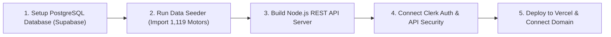

# CENTER MOTOR CLUB - Production Deployment Roadmap & Architecture Guide

This document outlines the step-by-step roadmap required to transition the **CENTER MOTOR CLUB** application from its current local prototype state into a **100% Secure, Scalable, Production-Ready Live Web Application**.

---

## 📊 Current State vs Production Target

| Component | Current Prototype State | Production Target State |
| :--- | :--- | :--- |
| **Frontend UI** | Static HTML5 + Vanilla CSS + JS | Next.js / Vite React / Production Frontend hosted on Vercel |
| **Data Storage** | Local static JSON file (`ht_motors_data.json`) | **Cloud Database** (PostgreSQL / Supabase / MongoDB) |
| **Backend Logic** | Local Python HTTP server (`http.server 8080`) | **Node.js Express / Next.js REST API** with database ORM |
| **Authentication** | Local Session Switcher & Clerk JS SDK demo | **Clerk Cloud Auth / Supabase Auth** with Server JWT validation |
| **Role Permissions** | Client-side UI toggling (`admin` vs `viewer`) | **Database & Middleware RBAC** (Server-side API route guards) |
| **PDF & Report Storage** | Client-side PDF generation (`html2pdf.js`) | **Cloud Blob Storage** (AWS S3 / Supabase Storage) for archived PDFs |
| **Domain & Hosting** | Ngrok tunnel (`ngrok-free.dev`) | **Custom SSL Domain** (e.g. `https://app.centermotorclub.com`) |

---

## 🚀 Complete Production Action List (Step-by-Step)

### 1. Database Setup (Real-Time Cloud DB)
- **Problem now**: Data is stored in `ht_motors_data.json`. Any server restart or multi-user edit loses sync.
- **Production Solution**: Use a PostgreSQL database (via **Supabase** or **AWS RDS** or **Neon Tech**).
- **Schema Tables to Create**:
  1. `users` table: User ID, Name, Email, Password Hash, Role (`admin` or `viewer`), Department Scope.
  2. `motors` table: Motor ID, Serial No, Application Name, Category (`HT` or `LT`), Plant/Department, Power kW, Voltage, Current, RPM, Frame Size, Make, Status, Critical Flag.
  3. `test_logs` table: Log ID, Motor ID, Test Date, Due Date, Report No, Tan Delta 0.2VL, Phase-Ground, Tip-Up %, Remarks, Tested By User ID.
  4. `audit_logs` table: History tracking of who added, edited, or deleted any motor record.

---

### 2. Data Migration & Seeding (Migrating 1,119 Motors)
- **Action**: Write a Python / Node.js **Database Seeder script** to automatically import all existing **1,119 motor records** (769 HT + 350 LT) from `ht_motors_data.json` directly into your production PostgreSQL database.
- **Result**: Zero data loss — all existing plant motor records will be live in the production database instantly.

---

### 3. Backend API Development (Node.js / Express or Next.js)
- **Action**: Create REST API endpoints to handle all database CRUD operations securely:
  - `GET /api/motors` -> Fetch filtered motors with server-side pagination.
  - `POST /api/motors` -> Register new HT/LT motor (Admin guard required).
  - `PUT /api/motors/:id` -> Update motor specs / test results (Admin guard required).
  - `DELETE /api/motors/:id` -> Delete motor record (Admin guard required).
  - `GET /api/kpis` -> Aggregated real-time metrics (Total, HT, LT, Critical, Done, Due, RPM ratio).
  - `GET /api/users` & `POST /api/users` -> User management endpoints.

---

### 4. Server-Side Authentication & Security (Clerk / JWT Middleware)
- **Action**: Connect Clerk Auth or JWT Token middleware on the API server:
  - Validate JWT Bearer token on every incoming API request.
  - Reject unauthorized requests (`401 Unauthorized`).
  - Block non-admin users from calling `POST`, `PUT`, or `DELETE` API endpoints (`403 Forbidden`).

---

### 5. Cloud Storage for PDF Reports & QR Tags
- **Action**: Integrate **AWS S3** or **Supabase Storage**:
  - Automatically save generated PDF Test Certificates to cloud storage.
  - Generate permanent public/private download links for field technicians scanning QR codes.

---

### 6. Historical Maintenance Trends & Audit Logging
- **Action**: Build a **Historical Test History** tab for each motor:
  - Allows engineers to view Tan Delta insulation trends over 5 to 10 years on line charts.
  - Tracks degradation over time to predict motor failure before it occurs.

---

### 7. Production Deployment & Domain Hosting
- **Frontend Hosting**: Deploy to **Vercel** or **Netlify** (Free SSL certificate, instant global CDN, auto-deploy from GitHub repository).
- **Backend/Database Hosting**: Deploy Node.js server to **Render / Railway / AWS** and Database to **Supabase / Neon**.
- **Custom Domain**: Connect your domain (e.g. `https://centermotorclub.com`).

---

## 🛠️ Recommended Tech Stack Summary for Production

| Layer | Recommended Technology | Why it's best |
| :--- | :--- | :--- |
| **Frontend** | React / Next.js + TailwindCSS / Vanilla CSS | Fast, SEO-ready, interactive UI |
| **Backend API** | Node.js (Express) or Next.js API Routes | Lightweight, fast JSON handling |
| **Database** | PostgreSQL (via Supabase / Prisma ORM) | Robust, relational, industrial-grade |
| **Auth** | Clerk Auth or Supabase Auth | Ready-made login, RBAC, OAuth |
| **Hosting** | Vercel (Frontend) + Supabase (Database & Storage) | 0 server maintenance, scalable |

---

## 🎯 Implementation Roadmap Next Steps

